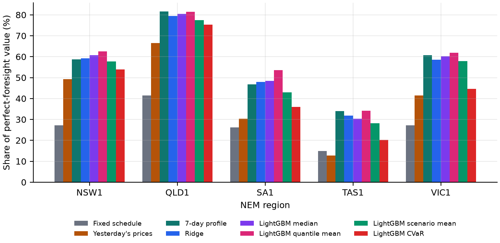
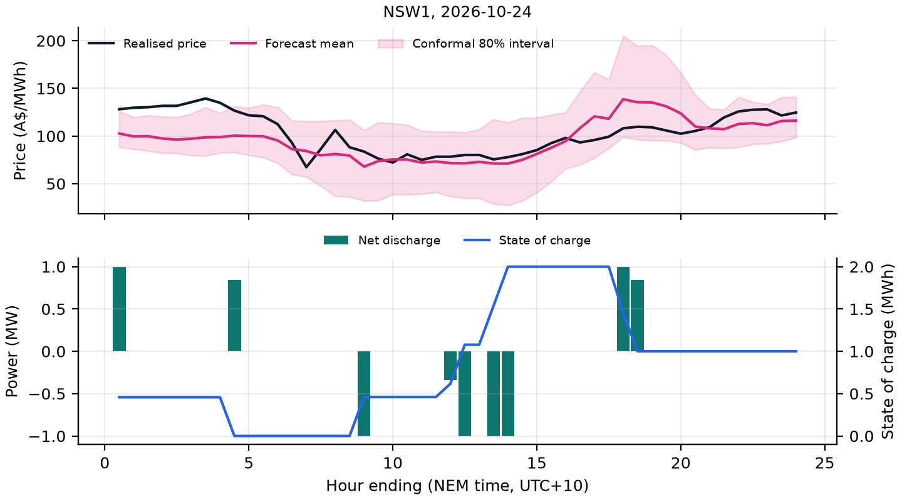
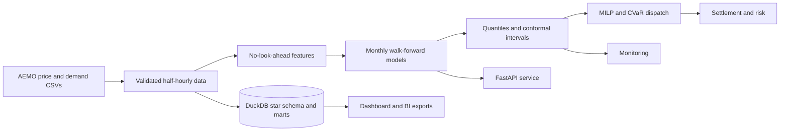

# NEM Battery Lab

[](https://github.com/fronzi/nem-battery-lab/actions/workflows/ci.yml)

**Does better price forecasting make a grid battery more valuable?** This project answers that
question end to end on public Australian electricity-market data: ingestion, a SQL star schema,
probabilistic forecasting, mixed-integer optimisation, risk analysis, an API and monitoring.

**Main finding.** LightGBM clearly improves forecast accuracy. That accuracy does not always become
money. Against yesterday's prices, its expected-price strategy adds value in all five regions. Against
a much simpler 7-day price profile, the added value is statistically clear only in
NSW1, SA1. The simple baseline is hard to beat, and this repository reports that plainly.



## Results

Test period: **1035 trading days per region, 1 Jan 2024 to 31 Oct 2026**. Models are refitted monthly
with earlier data only. Battery: 1 MW / 2 MWh, 85% round-trip efficiency, A$10/MWh discharge wear,
daily state of charge returns to 50%.

### Value by strategy (A$ per MW-year; share of perfect foresight)

| Strategy | NSW1 | QLD1 | SA1 | TAS1 | VIC1 |
|---|---|---|---|---|---|
| Fixed solar/evening schedule | 71k (27%) | 83k (42%) | 72k (26%) | 16k (15%) | 45k (27%) |
| Yesterday's prices | 128k (49%) | 133k (67%) | 83k (30%) | 14k (13%) | 69k (42%) |
| 7-day same-period profile | 153k (59%) | 163k (82%) | 128k (47%) | 36k (34%) | 100k (61%) |
| Ridge regression | 154k (59%) | 159k (79%) | 131k (48%) | 34k (32%) | 97k (59%) |
| LightGBM median | 158k (61%) | 161k (80%) | 133k (48%) | 32k (30%) | 99k (60%) |
| LightGBM quantile mean | 163k (63%) | 163k (81%) | 147k (54%) | 36k (34%) | 102k (62%) |
| LightGBM scenario mean | 150k (58%) | 155k (77%) | 118k (43%) | 30k (28%) | 96k (58%) |
| LightGBM CVaR | 140k (54%) | 150k (75%) | 99k (36%) | 22k (20%) | 74k (45%) |
| Perfect foresight (upper bound) | 260k (100%) | 200k (100%) | 274k (100%) | 106k (100%) | 165k (100%) |

### Forecast error (MAE, A$/MWh)

| Forecast | NSW1 | QLD1 | SA1 | TAS1 | VIC1 |
|---|---|---|---|---|---|
| Yesterday's prices | 71.7 | 49.5 | 94.9 | 41.0 | 61.4 |
| 7-day profile | 55.1 | 41.4 | 77.1 | 38.2 | 54.9 |
| Ridge | 50.5 | 37.9 | 69.9 | 34.2 | 49.1 |
| LightGBM median | 49.3 | 36.4 | 68.2 | 33.6 | 47.6 |
| LightGBM quantile mean | 49.9 | 37.7 | 68.2 | 34.0 | 47.5 |

### Pre-registered hypotheses ([plan](docs/RESEARCH_PLAN.md))

| ID | Outcome | Evidence |
|---|---|---|
| H1: LightGBM beats yesterday's prices on MAE | **Supported** | Daily MAE falls by A$7.5 to A$26.7/MWh; Diebold-Mariano p ≤ 7.2e-06 in all regions |
| H2: conformal calibration improves coverage | **Supported** | 80% interval: 71.9%-74.9% before, 79.6%-80.3% after. 90% interval: 83.7%-86.0% before, 89.6%-90.1% after |
| H3: LightGBM dispatch beats dispatch on yesterday's prices | **Supported** | Uplift A$22,657 to A$63,751 per MW-year; every Holm-adjusted p ≤ 0.004 |
| H4: CVaR dispatch improves tail outcomes | **Not supported** | The 5% daily CVaR difference is statistically clear in 0 of 5 regions. Mean value is lower in all 5 regions, and the interval is entirely below zero in 4 |

### The harder comparison (added after seeing the results)

I added this analysis when the 7-day profile turned out to be stronger than the pre-specified baseline.
Treat it as exploratory.

| Region | Uplift vs 7-day profile (A$/MW-yr) | 95% block-bootstrap CI | Holm-adjusted p |
|---|---|---|---|
| NSW1 | 10,148 | 3,296 to 17,815 | 0.036 |
| QLD1 | -400 | -4,276 to 2,330 | 0.930 |
| SA1 | 18,727 | 4,623 to 35,286 | 0.032 |
| TAS1 | 234 | -8,763 to 5,506 | 1.000 |
| VIC1 | 1,973 | -3,106 to 5,258 | 0.734 |

The forecast is still more accurate than the 7-day profile (daily MAE lower by
A$4.6 to A$8.9/MWh). Dispatch value depends mostly on getting the
*shape and extremes* of the day right, so lower average error does not translate one-for-one into revenue.

<p align="center"></p>

## Skills demonstrated

| Target role | Essential skills shown here | Highly desirable extensions shown here |
|---|---|---|
| **Senior Data Scientist** | Python, advanced SQL (window functions, marts), feature engineering, walk-forward evaluation, baselines, statistical testing | Star schema, BI-ready Parquet, interactive [dashboard](results/dashboard.html), decision-focused metrics |
| **Machine Learning Engineer** | Packaged code, typed modules, tests, CLI, FastAPI serving, model artefacts | Docker, GitHub Actions, data-quality gates, PSI drift and coverage monitoring, run manifests |
| **Energy Modelling / Optimisation Scientist** | Market data, battery physics, MILP dispatch, efficiency and wear | Scenario optimisation, CVaR, perfect-foresight benchmark, five-region comparison |
| **Quantitative Analyst / Researcher** | No-look-ahead backtesting, P&L attribution, drawdown, VaR/CVaR | Block bootstrap, Holm correction, Diebold-Mariano tests, conformal intervals |
| **Applied / AI Scientist** | Quantile gradient boosting, pre-registered hypotheses, honest baselines | Conformalised quantile regression, translating ML into decisions |
| **R&D Scientist / Research Manager** | Decision question, milestones, risk register, reproducible reporting | [Research plan](docs/RESEARCH_PLAN.md), [decision log](docs/DECISIONS.md), [model card](docs/MODEL_CARD.md) |

## Architecture



## Run it

```bash
make install
make test
.venv/bin/nem-lab all          # downloads about 120 MB and reproduces every table and figure
make serve                     # after `nem-lab all`: http://127.0.0.1:8000/docs
```

```bash
docker build -t nem-battery-lab .
docker run -p 8000:8000 nem-battery-lab   # /health and /dispatch; /forecast needs mounted /data
```

| Endpoint | Purpose |
|---|---|
| `POST /dispatch` | Optimal schedule for 48 half-hourly prices |
| `GET /forecast/{region}` | Next-day price quantiles from the trained bundle |
| `GET /health` | Service health |

## Data quality and monitoring

- 2,541,600 five-minute records across five regions; 0 missing half-hours and 0 duplicates.
- Warehouse tests check fact grain, foreign keys and valid trading periods. All return zero failures.
- Conformal 80% coverage ranged from 65% to 91% by region-month.
- At least one feature exceeded PSI 0.25 in 99% of region-months, even against the same month a
  year earlier. PSI is therefore a useful diagnostic here, but too sensitive to trigger retraining alone.

## Assumptions and limits

- **This is a research backtest, not an investment or trading recommendation.**
- The battery is a price taker: no market impact, bids, rebidding or dispatch constraints.
- Prices are half-hourly averages of 5-minute prices. A real battery can act within the half hour.
- Excludes FCAS, network charges, market fees, financing, capacity fade and outages.
- Forecasts use market history and calendar features only. Weather and AEMO pre-dispatch forecasts are absent.
- 2024-2026 contains large price spikes. Results depend on that regime.

**What would change the conclusion:** adding pre-dispatch and weather forecasts, 5-minute co-optimised
dispatch with FCAS, or a longer test period with a different volatility regime.

## Data and attribution

Source: [Australian Energy Market Operator (AEMO), Aggregated Price and Demand Data](https://aemo.com.au/energy-systems/electricity/national-electricity-market-nem/data-nem/aggregated-data).
AEMO is the author of the source material, used under its [copyright permissions](https://aemo.com.au/privacy-and-legal-notices/copyright-permissions).
Raw data are downloaded by the pipeline and are not stored in this repository.

Companion project: [trustworthy-materials-ml](https://github.com/fronzi/trustworthy-materials-ml).
Developed with AI coding assistance. Licensed under MIT.
